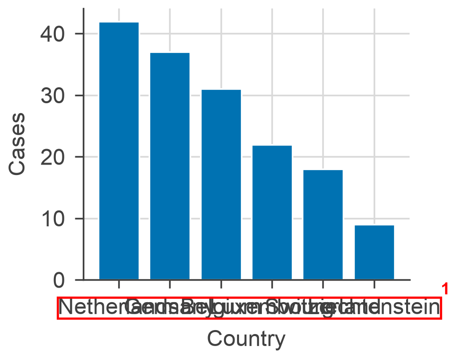
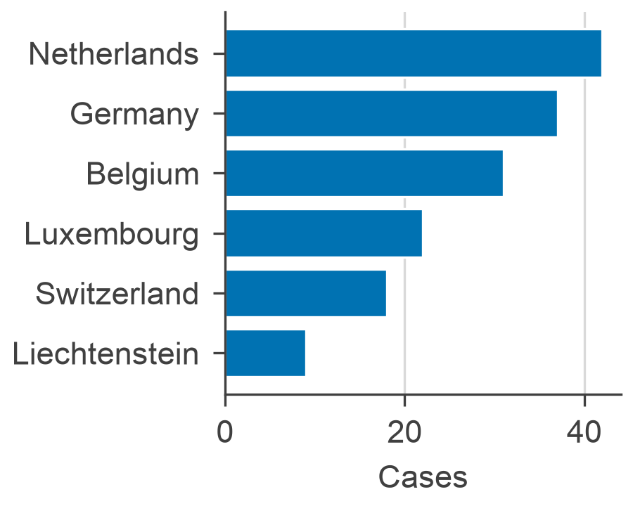
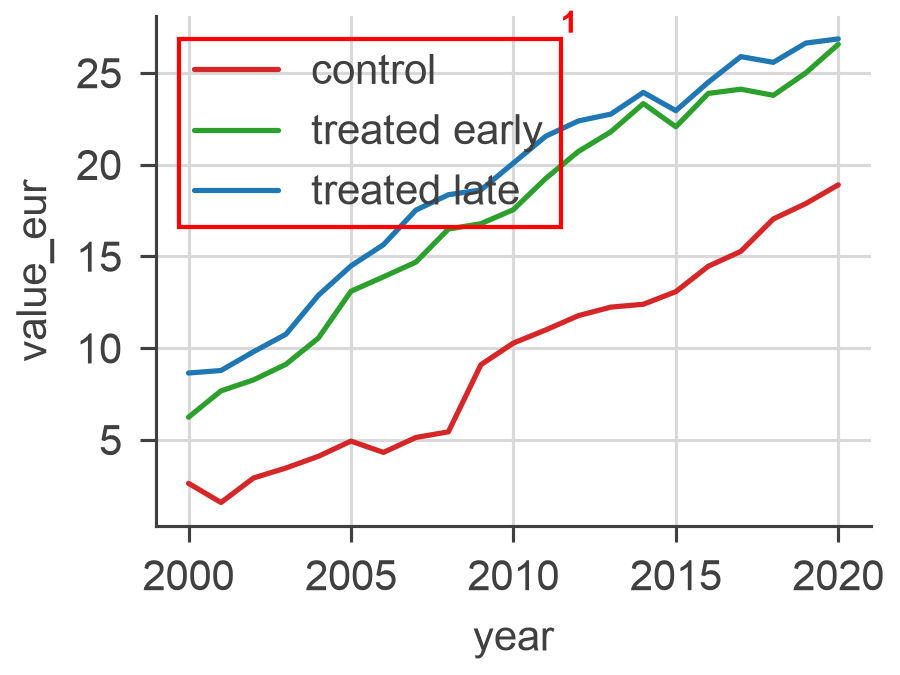
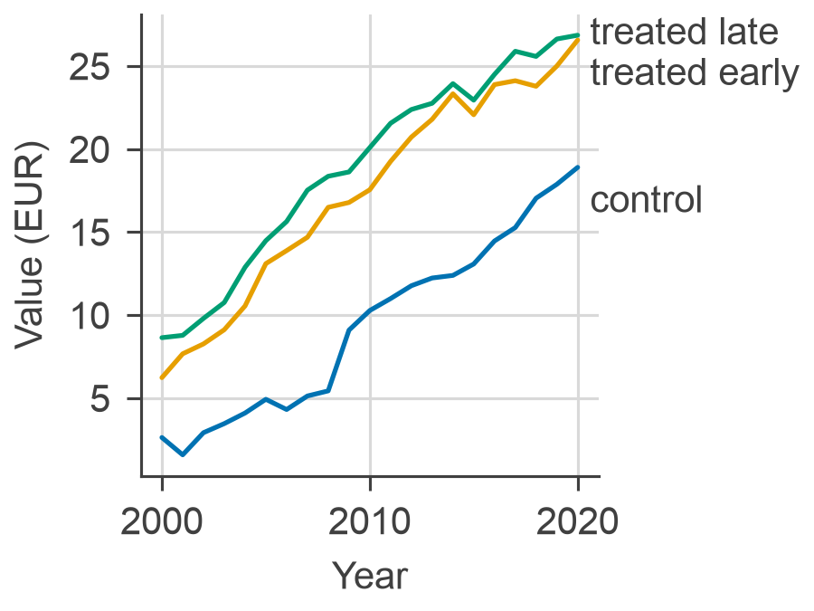
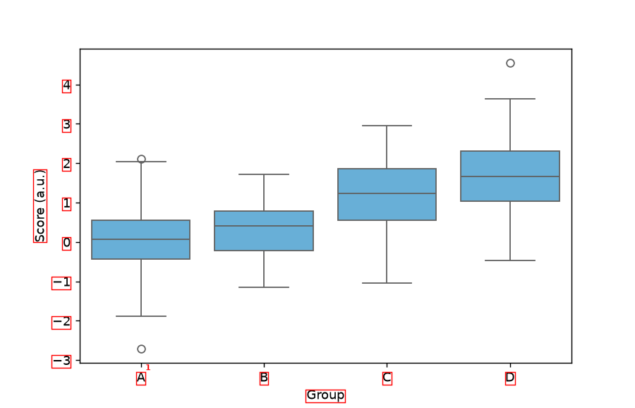
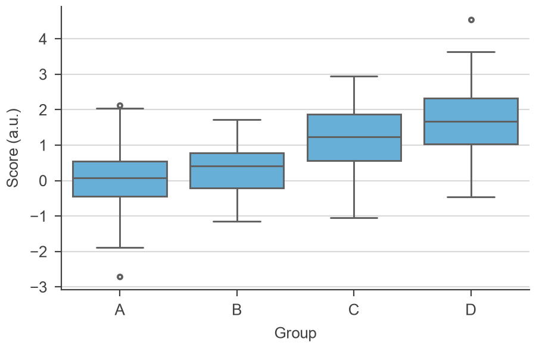

# plottino

Paper-ready figures with matplotlib and seaborn. plottino sets the figure to the size
it will be printed at, styles it for the journal (or your LaTeX document), and then
**checks that it is legible**: no overlapping or cut-off labels, no text under data,
no fonts or lines too small to print, no colours that colour-blind readers cannot tell
apart.

```python
import plottino as pt
import seaborn as sns

pt.use('science')                      # journal sizes + a decluttered style (also sets seaborn)
fig, ax = pt.figure('double', aspect=0.5)
sns.lineplot(data=df, x='year', y='value', hue='group', ax=ax)
ax.set(xlabel='Year', ylabel='Value (EUR)')
pt.save(fig, 'plots/fig1')             # checks, then writes fig1.pdf and fig1.png
```

## Before and after

Left: figures as they often start, with the problems plottino boxes and numbers. Right: the
same data after following its report; these pass the check. All images are shown at the same
width, as they would print. Made by [examples/readme_figures.py](examples/readme_figures.py).

### Crowded labels

| Before | After |
|:---:|:---:|
|  |  |

```
plottino check: Science, figure 2.24 x 1.80 in
  x error   text_overlap     6 x tick labels overlap in axes 0: use fewer ticks, rotate them, swap the axes or widen the panel
```

Long category names fit as horizontal bars, where they have room to be read.

### Legend on the data, colours colour-blind readers cannot tell apart

| Before | After |
|:---:|:---:|
|  |  |

```
plottino check: LaTeX (345pt text, 10pt font), figure 2.39 x 1.79 in
  ! warning legend_over_data the legend covers data in axes 0: move it (loc=, bbox_to_anchor=) or label the lines directly
  ! warning colors           #d62728 and #2ca02c look alike with deuteranopia (dE 3.9 < 6): change one, or add markers, line styles or direct labels
  i info    labels           y label "value_eur" of axes 0 looks like a variable name; write it for the reader, with units
```

The default palette (Okabe-Ito) is safe for colour blindness, `pt.label_lines(ax)` replaces
the legend with labels at the end of each line, and the axis labels are written for the reader.

### A figure made at screen size, then shrunk into a column

| Before | After |
|:---:|:---:|
|  |  |

```
plottino check: PNAS, figure 7.00 x 4.50 in, printed at 3.42 in wide
  x error   font_size        14 text(s) print at 4.9 pt, below the PNAS minimum 6 pt: e.g. x tick label "A" (axes 0); ...
  ! warning size             width 7.00 in will be scaled to 3.42 in (single), by 49%; fonts and lines are checked at that scale
```

A figure tuned on screen at 7 in wide, in matplotlib's default style, is shrunk by half to fit
a column, and every font and line with it. `pt.figure('single')` makes the figure at the column width, so
the sizes set are the sizes printed.

## LaTeX / Overleaf documents

Size figures as a fraction of the text width, as you would in `\includegraphics`:

```python
pt.use_latex()                              # Overleaf default: article, 10pt (\textwidth = 345pt)
pt.use_latex(textwidth='a4-1in', fontsize=11)   # geometry with 1in margins on A4
pt.use_latex(textwidth=418.25)              # the value \the\textwidth prints in your document
pt.use_latex(textwidth=505, columnwidth=241)    # two-column: also \linewidth / \columnwidth

fig, ax = pt.figure(r'0.5\textwidth')       # made at exactly half the text width
pt.save(fig, 'fig2')                        # prints: \includegraphics[width=0.5\textwidth]{fig2}
```

The figure is built at its printed size and its text at the document's `\footnotesize`
(8 pt in a 10 pt document), so LaTeX does not shrink anything: what you set is what is
printed. A figure made at another size can still be checked at the size it will be used:
`pt.check(fig, width=r'0.5\textwidth')` scales fonts and lines accordingly and flags any
that become too small.

## What is checked

| check | finds |
|---|---|
| `size` | width not one of the journal's column widths; height over the page maximum |
| `text_overlap` | text overlapping text: crowded tick labels, labels on labels, annotations (rotation-aware) |
| `text_clipped` | text cut off at the figure edge or hidden by axes clipping |
| `text_over_data` | annotations on lines or markers, or on fills with too little contrast |
| `legend_over_data` | a legend box covering lines or points |
| `font_size` | text below the journal minimum at print size (above its maximum: info) |
| `font_family` | text not in the journal's fonts (info) |
| `line_width` | lines, ticks and axes thinner than the journal minimum at print size |
| `marker_size` | symbols smaller than the journal minimum (Science: 5 pt) |
| `contrast` | text whose colour is too close to its background (WCAG ratio < 3) |
| `colors` | data colours hard to tell apart, with normal vision or simulated protanopia, deuteranopia or tritanopia |
| `colormap` | rainbow colormaps (jet, hsv, ...) |
| `labels` | axes without labels, labels like `mean_auc_score`, several series without a legend |
| `journal_rules` | the journal's house rules: Science: no figure title in the image, no minor ticks, no red with green, no dark blue with yellow; Nature: axis lines and ticks, no gridlines, no coloured text; Cell: no figure title in the image, no red with green; all: units in axis labels, panel letters in the right case |

Checks run on what matplotlib actually draws, so they work on any matplotlib or seaborn
figure. Use them directly:

```python
report = pt.check(fig)             # or pt.check(fig, journal='nature', width='single')
print(report); report.ok           # ok = no errors
report.highlight()                 # numbered red boxes on the figure; pt.clear_highlights(fig)
report.raise_for_errors()          # e.g. in a test or CI
pt.ignore(text, 'text_over_data')  # a label that sits on a bar on purpose
pt.check(fig, skip=['font_family'])
```

`pt.save(fig, path, strict=True)` refuses to save a figure with errors.

**Saving with `bbox_inches='tight'`** keeps text that sticks out of the figure, but the
saved file is then wider than designed, and shrinks when placed at the column width.
`pt.save(fig, path, bbox_inches='tight')` (or `pt.check(fig, tight=True)`) checks the tight
canvas and reports the resulting scale, e.g. a 6 pt footnote that prints at 5.7 pt.

## Journal presets

`science`, `sciadv` (Science Advances), `nature`, `pnas`, `cell`, `generic`, plus `pt.latex(...)`
for any LaTeX document. Each preset records its source (`pt.journals.get('nature').source`):
guidelines change, so check them before submitting.

| | widths | text | panel letters | min line | source |
|---|---|---|---|---|---|
| Science | 5.7 / 12.1 / 18.4 cm | 8 pt (6-8) | 9 pt bold, A B C | 0.28 pt | [widths](https://www.science.org/content/page/instructions-preparing-initial-manuscript), [figure guide 2026](https://www.science.org/cms/asset/76887697-528f-4a22-afea-cee904504e76/sciadv_guide_to_preparing_figures_2026.pdf) |
| Science Advances | 9 / 14.4 (max) / 18.4 cm, max height 9 in | 8 pt (6-8) | 9 pt bold, A B C | 0.28 pt | [figure guide 2026](https://www.science.org/cms/asset/76887697-528f-4a22-afea-cee904504e76/sciadv_guide_to_preparing_figures_2026.pdf) |
| Nature | 89 / 183 mm, max height 170 mm | 5-7 pt | 8 pt bold, a b c | 0.25 pt | [specifications](https://research-figure-guide.nature.com/figures/preparing-figures-our-specifications/) |
| PNAS | 8.7 / 11.4 / 17.8 cm, max height 22.5 cm | 6-8 pt | not specified | 0.25 pt | [digital art guidelines 2022](https://www.pnas.org/pb-assets/authors/digitalart-1675347574760.pdf) |
| Cell | 85 / 114 / 174 mm (3-column journals: 55 / 114 / 174), max height 20 cm | 6-8 pt | capitals, A B C | 0.5 pt | [figure guidelines](https://www.cell.com/information-for-authors/figure-guidelines) |

Add your own with `pt.journals.register('mykey', pt.Journal(...))`.

## Helpers

- `pt.panel_labels(axes)`: bold A, B, C (or a, b, c for Nature) at the panel corners
- `pt.label_lines(ax)`: label lines at their right end instead of a legend, nudged apart
- `pt.emphasize(ax, keep=['treated'])`: grey out everything but the series that carry the message
- `pt.OKABE_ITO`: the default colour-blind-safe palette; `pt.GREY`, `pt.LIGHT`, `pt.TEXT`
- `pt.colors.check_palette([...])`: colour pairs that are hard to tell apart

## Examples

[examples/examples.ipynb](examples/examples.ipynb): a LaTeX figure, checking and highlighting
problems, the fixed version, journal presets with seaborn, rescaling, palettes and saving.
[examples/latex_example.py](examples/latex_example.py): the same as a script.

## Install

```
pip install -e .            # from a clone
pip install -e '.[test]' && pytest
```

## References

- Okabe & Ito (2008), *Color Universal Design*: the default palette.
- Machado, Oliveira & Fernandes (2009), *A physiologically-based model for simulation of
  color vision deficiency*, IEEE TVCG 15(6): colour-blindness simulation.
- Ottosson (2020), *A perceptual color space for image processing* (OKLab): colour distances.
- WCAG 2.1 contrast ratio: text contrast.
